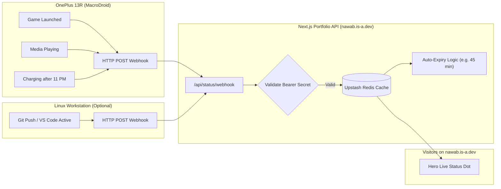

# Automated Live Status Architecture & Design

> **Document Version:** 1.0
> **Target Platform:** Nawab Shaikh's Engineering Portfolio (`nawab.is-a.dev`)
> **Client Environments:** OnePlus 13R (OxygenOS / Android) & Linux Dev Workstation

---

## 1. Objective

Enable the portfolio's hero section live status line to update automatically in real-time based on actual daily activities (gaming, watching media, coding, or sleeping) without requiring manual entry through `/admin` every time.

---

## 2. Activity Detection Matrix

| Category | Detectable Events | Detection Source | Battery / Performance Impact |
| :--- | :--- | :--- | :--- |
| **Media Playback** | Spotify, YouTube Music, Netflix, YouTube (App, media title/artist) | Android `MediaSessionManager` | Negligible (event broadcast) |
| **Mobile Gaming** | Specific game package launches (e.g., Genshin, PUBG, Emulators) | Android `UsageStats` / Accessibility | Low |
| **Device State** | Screen locked/unlocked, charging, Do Not Disturb, bedtime | Android OS Broadcast Receivers | Zero |
| **PC Dev Work** | VS Code active workspace, Git push events, terminal activity | Local PC background daemon or git hook | Negligible |
| **PC Gaming** | Steam running, Discord Rich Presence | Discord / Lanyard API | Cloud-to-cloud |

---

## 3. Evaluated Approaches

### Approach A: Phone Automation App (MacroDroid / Tasker)
* **Mechanism:** MacroDroid runs on the OnePlus 13R. When predefined trigger events occur (e.g., game launches, media starts playing, phone goes to sleep), it fires an HTTP `POST` webhook to `https://nawab.is-a.dev/api/status/webhook`.
* **Pros:**
  - Zero custom Android app development required.
  - Complete user control over which apps are whitelisted.
  - Highly responsive (fires within 1–2 seconds of app launch).
* **Cons:**
  - Requires battery optimization exemption on OxygenOS so the background process is not killed.

### Approach B: Cloud Presence Hub (Discord + Lanyard / Spotify API)
* **Mechanism:** Discord tracks PC games, Spotify, and custom status. A free open-source service called **Lanyard** provides a REST API of your real-time Discord presence.
* **Pros:**
  - Zero setup on the phone; purely cloud-to-cloud.
  - Automatically captures all Steam/PC games and Spotify tracks.
* **Cons:**
  - Does not detect mobile-native apps or phone-only games unless Discord is actively running and configured on the phone.

### Approach C: Custom Native Android App
* **Mechanism:** Author and compile a dedicated Android APK targeting Android SDK.
* **Pros:** Complete customization.
* **Cons:** Massive overkill, requires ongoing maintenance with every Android update, manual APK installs.

---

## 4. Recommended Architecture: Hybrid Webhook + TTL Expiry

The optimal solution combines **MacroDroid webhooks** for mobile activities with an **automatic TTL (Time-To-Live) fallback** on the portfolio server.



---

## 5. System Design Details

### 5.1 Portfolio Webhook Endpoint (`/api/status/webhook`)
* **Method:** `POST`
* **Authentication:** Secret pre-shared key in header (`X-Webhook-Secret: <SECRET_KEY>`)
* **Payload Example:**
  ```json
  {
    "category": "gaming",
    "text": "Playing Genshin Impact",
    "durationMinutes": 60
  }
  ```
* **Validation & Whitelist:**
  - Enforce a strict whitelist of allowed categories: `gaming`, `coding`, `reading`, `music`, `offline`, `focus`.
  - Sanitize all incoming text (max 40 characters) to keep the Swiss poster aesthetic intact.

### 5.2 Automatic TTL (Time-To-Live) & Stale Status Prevention
To prevent the portfolio from showing "Playing Game" for 3 days if your phone battery dies:
1. Every automated update has a built-in expiration timestamp (e.g., 45 minutes).
2. When the status is fetched, if `Date.now() > expiresAt`, the status automatically resolves to a calm default:
   - Example: `"At desk · Building systems"` or `"Offline"`.

---

## 6. Privacy & Security Rules

1. **Explicit Whitelist Only:** Never send generic "Active Window" or current app titles blindly. Only specific designated apps (e.g., approved games, Spotify, YouTube Music) trigger updates.
2. **Never Track Sensitive Apps:** Banking, messaging (WhatsApp, Signal), email, and personal tools must never be exposed or logged.
3. **Secret Token Rotation:** The webhook secret is stored as an environment variable in Vercel (`AUTO_STATUS_SECRET`) and never exposed in client bundles.

---

## 7. OnePlus / OxygenOS Setup Notes

Because OxygenOS aggressively suspends background apps to preserve battery:
1. **Disable Battery Optimization:** In Android Settings $\rightarrow$ Apps $\rightarrow$ MacroDroid $\rightarrow$ Battery usage $\rightarrow$ Set to **"Unrestricted"**.
2. **Lock in Recent Apps:** Open the app switcher, tap the three dots on MacroDroid, and select **"Lock"**.
3. **Notification Access:** Enable Android Notification Listener permission so MacroDroid can detect media playback without polling.

---

## 8. Next Steps & Implementation Milestones

When ready to implement:
- [ ] **Milestone 1:** Add the secured webhook endpoint in the Next.js portfolio (`/api/status/webhook`).
- [ ] **Milestone 2:** Implement TTL expiration logic in `lib/status.ts`.
- [ ] **Milestone 3:** Create MacroDroid macros on OnePlus 13R for gaming, media, and sleep triggers.
- [ ] **Milestone 4:** End-to-end test with a sample game launch on the phone.
